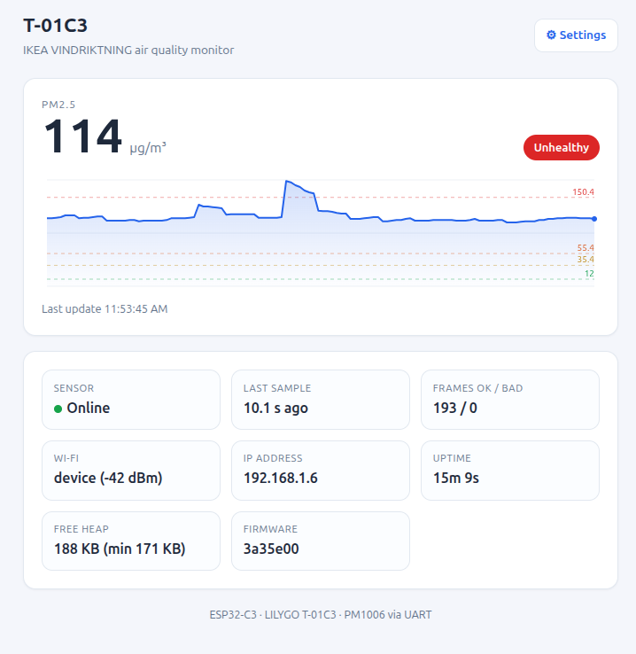

# LILYGO T-01C3 · IKEA VINDRIKTNING air quality monitor



ESP-IDF project for the ESP32-C3 on the [LILYGO T-01C3](https://lilygo.cc/en-us/products/t-01c3), reading the particulate sensor inside an IKEA VINDRIKTNING air quality monitor over UART. A built-in web UI shows live PM2.5 data, and Wi-Fi provisioning plus firmware updates live on a separate settings page.

## Layout

- `main/` — thin entry point (init, sensor start, mDNS, OTA rollback confirm).
- `components/pm1006/` — receive-only UART driver for the Cubic PM1006 sensor (IKEA VINDRIKTNING `REST` pad).
- `components/wifi_manager/` — AP+STA provisioning, Wi-Fi scan, credential storage in NVS, connect, background reconnect with backoff, and switch to STA-only.
- `components/web/` — HTTP server: dashboard (`/`), settings page (`/settings`), JSON API (`/api/data`), scan/connect endpoints, and streaming OTA upload.

## Pages

| Path | Purpose |
| --- | --- |
| `/` | Live dashboard: PM2.5 value and band, 4-minute trend, sensor/Wi-Fi/uptime/heap status. |
| `/settings` | Wi-Fi network provisioning and firmware `.bin` upload. |
| `/api/data` | JSON snapshot used by the dashboard (`pm25`, `sensor_online`, `age_ms`, `frames_ok`, `frames_bad`, `rx_bytes`, `uptime_s`, `heap`, `heap_min`, `reconnects`, `ssid`, `rssi`, `ip`, `fw`, `idf`). |

## Discovery

The device answers mDNS as **`aqi.local`** (hostname `aqi`, set in `main/main.c`), so it can be opened at `http://aqi.local/` without knowing its IP. It also advertises the web UI as an `_http._tcp` service on port 80 under the instance name "T-01C3 Air Quality Monitor", for example:

```sh
avahi-resolve -n aqi.local          # aqi.local  192.168.1.42
avahi-browse -rt _http._tcp         # lists the device
```

Rename the host in `main/main.c` if a second device would collide with `aqi.local`. If the name is already claimed on the network, mDNS renames the device (for example `aqi-2.local`) and logs a warning; the status log below always prints the name actually in use.

Once a minute the device logs a status line with the link state, IP, RSSI, reconnect count, free and minimum-free heap, and the mDNS name, which makes a slow heap leak or a link that keeps dropping visible over a long run:

```text
I (86400312) app: wifi=up ip=192.168.1.42 rssi=-58 reconnects=1 heap=118640 min_heap=102752 mdns=aqi.local
```

## PM2.5 sensor wiring

The VINDRIKTNING control board exposes the PM1006 UART stream on the `REST` pad. The sensor streams 20-byte frames at 9600 baud, 8N1, and the driver only listens (no request is sent).

| Sensor board | ESP32-C3 |
| --- | --- |
| `REST` (UART TX, 5 V logic) | `GPIO9` (UART1 RX) via level shifter or divider |
| `GND` | `GND` |

The `REST` pad idles at 5 V while the ESP32-C3 GPIOs are 3.3 V and not 5 V tolerant, so a level shifter or a divider (for example 1 kΩ in series with 2 kΩ to GND) is required. GPIO9 is also the ROM boot-strap pin; the sensor line idles high, so normal boot is unaffected, but do not hold it low during reset.

The RX pin, UART port, and baud rate are configurable under `Component config → PM1006 particulate sensor (IKEA VINDRIKTNING)` in `idf.py menuconfig`. The driver validates the frame header and checksum, drops corrupt frames, and reports the age of the last valid reading; the dashboard keeps showing the last value greyed out when no frame has arrived for 30 seconds.

## Provisioning and Wi-Fi flow

The device boots in AP+STA mode. The access point password is always `password`; the network name is printed over serial (for example, `T01C3-123456`).

- No saved network: connect to the AP, open `http://192.168.4.1/settings` (or `http://aqi.local/settings`), pick a scanned SSID, enter its password, and connect.
- On success the device saves the credentials, joins the network, and switches to STA-only mode after a short delay. Credentials are only persisted after the link works, so a typo cannot strand the device on the next boot.
- Saved network: the device connects automatically on boot and switches to STA-only.

If the link drops, the station reconnects on its own with exponential backoff (5 s, 10 s, 20 s … capped at 5 minutes), so a router reboot or a daily lease change recovers without a power cycle. After four consecutive failures the provisioning AP is re-enabled, so the device is still reachable at `http://192.168.4.1/` while the upstream network is down; it switches back to STA-only once the link is up again. mDNS follows the station interface, so `aqi.local` resolves again as soon as the new IP is leased.

To re-provision, open the settings page while the AP or the home network is reachable.

## Build and first UART flash

```sh
idf.py set-target esp32c3
idf.py build
idf.py -p PORT flash monitor
```

Replace `PORT` with the board's serial device (for example, `/dev/ttyACM0` or `COM5`). The board may need its BOOT button held while resetting to enter the ROM serial bootloader.

The first build resolves the `espressif/mdns` managed component listed in `main/idf_component.yml`, so it needs network access to the component registry; `dependencies.lock` pins the resolved version.

## Upload a firmware `.bin` over Wi-Fi

1. Connect to the device network (`T01C3-xxxx` / `password`) or to the configured home network.
2. Open the settings page (AP: `http://192.168.4.1/settings`; STA: `http://aqi.local/settings` or `http://<device-ip>/settings`).
3. Select `build/esp32-c3-ikea-pm2-sensor.bin` and upload.

The update endpoint accepts only images that fit the inactive OTA slot and pass ESP-IDF image validation. The new image is selected only after the full image is received and verified; keep the device powered during an update.

## Partition and flash assumptions

`partitions.csv` reserves two equal 1.75 MiB OTA slots and is sized for a 4 MiB flash variant. Confirm the flash size for the exact board before flashing.
